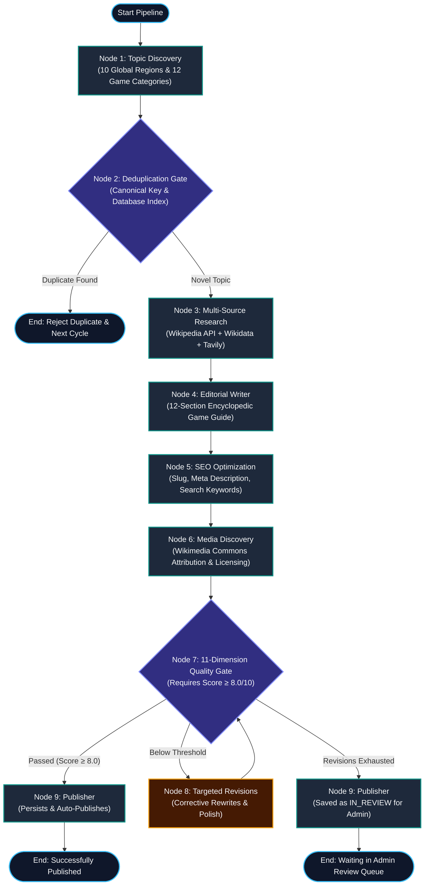

# WorldGames AI — Architecture & Multi-Agent Pipeline

WorldGames AI is an autonomous, multi-agent AI system built to research, generate, quality-audit, and publish comprehensive, 12-section encyclopedic guides for every game and sport in the world.

---

## 1. LangGraph State Machine Architecture

---

## 2. 12-Section Encyclopedic Article Specification

Every game/sport guide generated by the `writer_node` contains:

1. **Overview, Origins & Etymology**: Historical roots, founder culture, name meaning.
2. **Core Objective & Fundamental Concept**: Primary win conditions and gameplay philosophy.
3. **Playing Arena: Dimensions, Surface & Layout**: Court/pitch/board metrics in structured Markdown tables.
4. **Equipment & Gear Specifications**: Weight, material, standard dimensions of ball, board, or protective gear.
5. **Team Composition & Player Roles**: Specific positions, designations, and player duties.
6. **Official Rules & Match Progression**: Toss, innings/quarters/periods, legal vs illegal actions.
7. **Scoring System, Points & Winning Conditions**: Detailed points, technical fouls, overtime rules.
8. **Master Techniques, Skills & Tactical Strategies**: Key maneuvers, champion strategies, formations.
9. **Cultural Heritage, Rituals & Global Significance**: Rituals, chants, philosophical traditions.
10. **Premier Tournaments, Leagues & Legendary Figures**: World championships, hall-of-fame athletes.
11. **International Variations & Modern Evolution**: Regional adaptations, Olympic status, pro leagues.
12. **Getting Started Guide & Quick FAQs**: Beginner advice, starter drills, and common FAQs.

---

## 3. Node Responsibility Breakdown

| Node Name | Module Reference | Primary Responsibility |
| :--- | :--- | :--- |
| **`discover_node`** | `app/graph/nodes.py` | Rotates through 10 global regions and 12 game genres to discover both celebrated and obscure traditional games. |
| **`deduplicate_node`** | `app/graph/nodes.py` | Canonical key hashing and PostgreSQL index check to guarantee zero duplicate topics. |
| **`research_node`** | `app/graph/nodes.py` | Gathers verifiable facts, dimensions, and rules via Wikipedia REST API and Tavily Search. |
| **`writer_node`** | `app/graph/nodes.py` | Generates authoritative, 1500+ word guides structured into 12 sections with markdown tables. |
| **`seo_node`** | `app/graph/nodes.py` | Generates URL-friendly slugs, high-CTR meta descriptions, and search keyword arrays. |
| **`image_node`** | `app/graph/nodes.py` | Queries Wikimedia Commons for freely licensed images with author and CC license attribution. |
| **`quality_node`** | `app/graph/nodes.py` | Evaluates the draft across 11 quality dimensions. Only drafts $\ge 8.0/10$ auto-publish. |
| **`revision_node`** | `app/graph/nodes.py` | Performs targeted corrective rewrites if an article scores below threshold before re-scoring. |
| **`publisher_node`** | `app/graph/nodes.py` | Persists article, logs evaluation breakdown, invalidates cache, and updates 200/day counter. |
